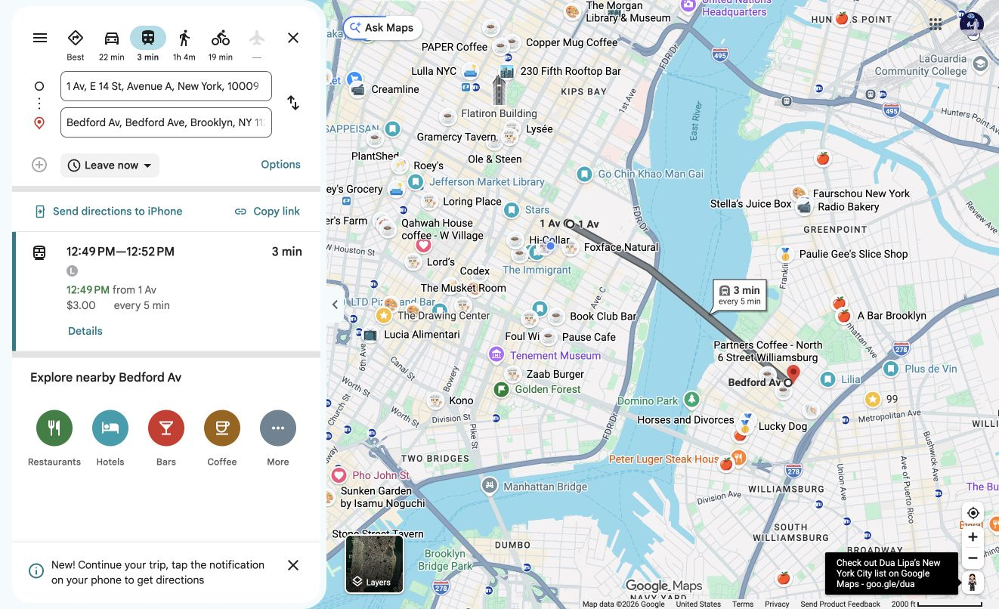
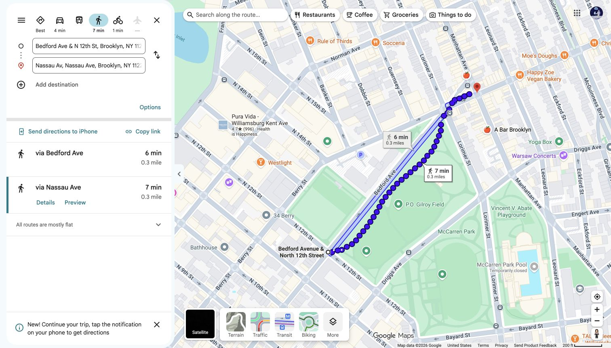
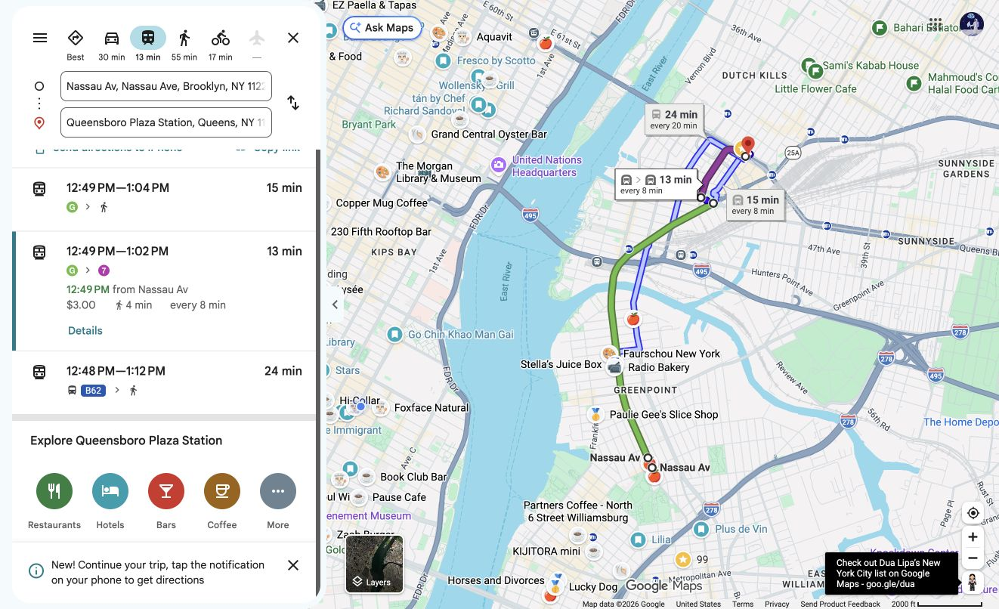
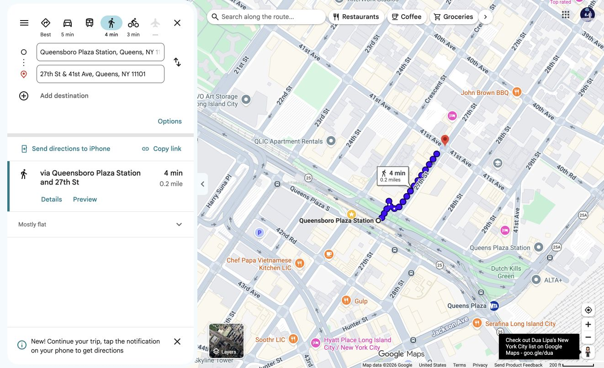
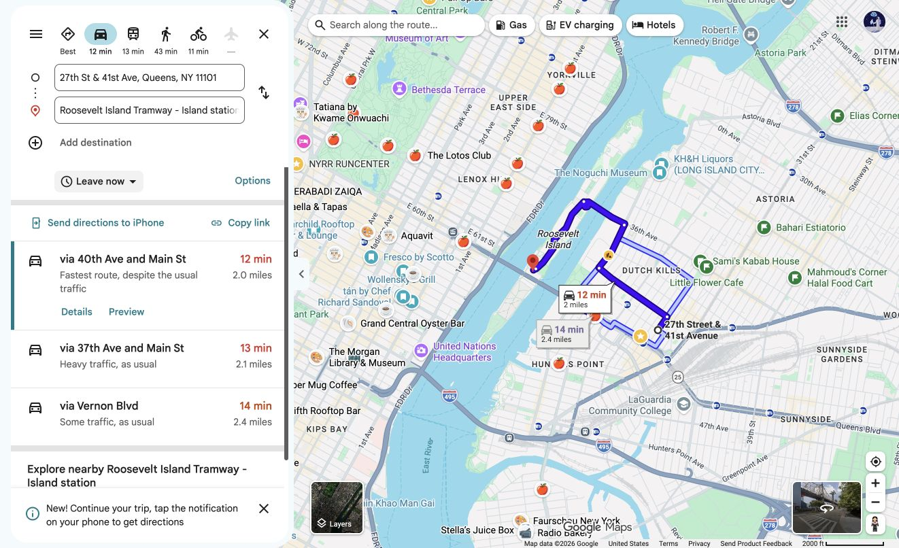

# NYC Marathon spectator itinerary: Manhattan → McCarren Park → Queens → Roosevelt Island Tram

**Sunday, November 1, 2026.** Runner starts around **10:20 a.m.** and expects **8:30 per mile**. This route cheers near McCarren Park, reaches Roosevelt Island **from Queens**, and rides the tram into Manhattan.

> **Timing:** Expect the runner at Bedford Avenue/North 12th Street around **11:55 a.m.–noon** if 10:20 is their actual start-line crossing. The Queensboro Bridge should be around **12:28–12:36 p.m.**, and First Avenue at East 72nd Street around **12:42–12:45 p.m.** This spectator trip is unlikely to catch the **same runner** from the tram or at East 72nd Street. The tram may offer a view of the *race field on the nearby Queensboro Bridge* if timing and visibility cooperate.

## The route

| Target time | Mode | What to do |
| --- | --- | --- |
| **By ~11:30 a.m.** | **L subway** | Enter [1 Av L station at East 14th Street](https://www.google.com/maps/search/?api=1&query=1+Av+L+station+E+14th+St+New+York). Take a **Brooklyn-bound L toward Canarsie** one stop to **Bedford Av**. The train ride is about **3 minutes**; allow for the wait. [Transit directions](https://www.google.com/maps/dir/?api=1&origin=1+Av+L+Station,+New+York,+NY&destination=Bedford+Av+L+Station,+Brooklyn,+NY&travelmode=transit). |
| **~11:35–11:45 a.m.** | **Walk** | From Bedford Av station at North 7th Street, walk **north on the east side of Bedford Avenue** to **North 12th Street**, about five blocks. The east side is the **McCarren Park side** at North 12th Street. Stay on that side of the race course. [Walking directions](https://www.google.com/maps/dir/?api=1&origin=Bedford+Av+L+Station,+Brooklyn,+NY&destination=Bedford+Ave+%26+N+12th+St,+Brooklyn,+NY&travelmode=walking). |
| **~11:45 a.m.–noon** | **Cheer** | Watch at [Bedford Avenue and North 12th Street, park side](https://www.google.com/maps/search/?api=1&query=Bedford+Ave+and+N+12th+St+Brooklyn+NY). Tell the runner the exact corner and side in advance. Use the [NYRR app](https://www.nyrr.org/tcsnycmarathon/race-day/watch-the-race) to adjust for their actual start and pace. |
| **After they pass** | **Walk** | Continue **north along the park side of Bedford**, then **east along the south sidewalk of Nassau Avenue** to the [Nassau Av G station at Manhattan Avenue](https://www.google.com/maps/search/?api=1&query=Nassau+Av+G+station+Manhattan+Ave+Brooklyn). Use the **southeast corner entrance** for the Queens-bound platform. This keeps you on the same side of the course; do not cut across Bedford, Nassau, or Manhattan Avenues. Google Maps shows about **0.3 mile / 7 minutes**. [Walking directions](https://www.google.com/maps/dir/?api=1&origin=Bedford+Ave+%26+N+12th+St,+Brooklyn,+NY&destination=Nassau+Av+G+Station,+Brooklyn,+NY&travelmode=walking). |
| **~12:05–12:25 p.m.** | **G, then 7 subway** | Take the **Queens-bound G to Court Sq**. Transfer **inside the station** to the **Flushing-bound 7** and ride **one stop to Queensboro Plaza**. [Transit directions](https://www.google.com/maps/dir/?api=1&origin=Nassau+Av+G+Station,+Brooklyn,+NY&destination=Queensboro+Plaza+Station,+Queens,+NY&travelmode=transit). This subway leg avoids crossing the Long Island City race route on foot or in a car. |
| **After Queensboro Plaza** | **Walk / cab pickup** | Exit and walk **north on 27th Street to 41st Avenue** (about **0.2 mile / 4 minutes**). Request a cab or rideshare at **27th St & 41st Ave, Queens**, rather than at the G's 21 St or Court Sq stops. [Walking directions](https://www.google.com/maps/dir/?api=1&origin=Queensboro+Plaza+Station,+Queens,+NY&destination=27th+St+%26+41st+Ave,+Queens,+NY&travelmode=walking). |
| **Allow ~15–30+ minutes** | **Cab over Roosevelt Island Bridge** | Set the destination to [**Roosevelt Island Tramway – Island Station**](https://www.google.com/maps/search/?api=1&query=Roosevelt+Island+Tramway+Island+Station), **not the Manhattan tram terminal**. Tell the driver to use the **Roosevelt Island Bridge from Queens at 36th Avenue and Vernon Boulevard**. A normal Google Maps drive from the pickup is about **2 miles / 12 minutes**; the wait, traffic, and police controls can make race day substantially slower. [Driving directions](https://www.google.com/maps/dir/?api=1&origin=27th+St+%26+41st+Ave,+Queens,+NY&destination=Roosevelt+Island+Tramway+Island+Station,+Roosevelt+Island,+NY&travelmode=driving). |
| **Likely ~12:45–1:20 p.m.** | **Tram** | Board the [Manhattan-bound Roosevelt Island Tram](https://www.rioc.ny.gov/community/transportation/tram). It travels **beside the Queensboro Bridge** and lands at **East 60th Street and Second Avenue**. Any view of runners depends on which tram window you get, the field's position, and the tram queue. |
| **Optional after the tram** | **Walk** | Walk north on Second Avenue and east on East 72nd Street to [First Avenue and East 72nd Street](https://www.google.com/maps/search/?api=1&query=40.7678056,-73.9560278), the crossing you identified (**40°46′04.1″N 73°57′21.7″W**). Google Maps gives about **0.7 mile / 17 minutes**. [Walking directions](https://www.google.com/maps/dir/?api=1&origin=Roosevelt+Island+Tramway+Manhattan+Station,+E+60th+St+and+2nd+Ave,+New+York,+NY&destination=40.7678056,-73.9560278&travelmode=walking). NYRR lists this as an **official pedestrian crossing zone**; cross First Avenue only when staff permit it. |

## Why the cab pickup is north of the course

The marathon goes through Long Island City on **44th Drive, Hunter Street, Crescent Street, and Queens Plaza South**, with nearby Queens Plaza North restrictions. A cab from **21 St–Van Alst** or **Court Sq** could have to cross or detour around those closures to reach the Roosevelt Island Bridge. The **G → 7 → Queensboro Plaza** subway route gets spectators to the north side first. The **27th St & 41st Ave** pickup and the suggested bridge approach are a geographic plan, **not a guarantee that a cab will be available or allowed through every intersection**. Follow police directions and the driver's live navigation. [NYC DOT marathon street list](https://home4.nyc.gov/html/dot/html/infrastructure/construction-embargoes.shtml) · [NYRR 2026 course](https://prod.nyrr.org/tcsnycmarathon/the-course).

**If a cab cannot reach the pickup:** Stay north of the course and use [walking directions from 27th St & 41st Ave to the island tram](https://www.google.com/maps/dir/?api=1&origin=27th+St+%26+41st+Ave,+Queens,+NY&destination=Roosevelt+Island+Tramway+Island+Station,+Roosevelt+Island,+NY&travelmode=walking). Google Maps estimates **about 43 minutes**, using the **pedestrian sidewalk on the Roosevelt Island Bridge**. Treat the [Q102 bus](https://www.mta.info/document/10321) as an option only if its live race-day route and stop access are confirmed; it may be diverted.

If police redirect pickups farther north, [31st St & 39th Ave](https://www.google.com/maps/search/?api=1&query=31st+St+and+39th+Ave+Queens+NY) is another north-of-course pickup point; it is about **0.5 mile / 12 minutes** on foot from Queensboro Plaza. [Alternate pickup driving map](spectator-maps/06-queens-pickup-to-island.png).

## Map screenshots

These are **normal Google Maps routes, captured before race day**. They do not model marathon closures or guarantee a taxi time. Follow the street-side instructions above where a map line touches the course.

**1. L train: 1 Av → Bedford Av.**

**2. Bedford/North 12th → Nassau Av G.** Keep to the McCarren Park side of Bedford and the south sidewalk of Nassau; use the southeast station entrance.

**3. G to Court Sq, then 7 to Queensboro Plaza.** Choose the **G → 7** option shown here; Google Maps also offers a walk from Court Sq that would lead back toward marathon restrictions.

**4. Queensboro Plaza → 27th St & 41st Ave taxi pickup.**

**5. Queens taxi pickup → Roosevelt Island tram station by bridge.** The screenshot's **12 minutes** is a normal traffic estimate only.

**6. Manhattan tram terminal → First Avenue and East 72nd Street.**

## Before leaving

- Check [MTA planned service changes](https://www.mta.info/planned-service-changes) for the **L, G, and 7** on race morning.
- Check [Roosevelt Island Tram service](https://www.rioc.ny.gov/community/transportation/tram) and allow time for its line.
- Use the runner's **actual start-line crossing** in the [NYRR tracker](https://www.nyrr.org/tcsnycmarathon/race-day/watch-the-race). The estimates above use a steady 8:30/mile from 10:20 a.m.
- Read the [official 2026 course map](https://cms.prod.nyrr.org/api/document-files/file/TCSNYCM26_Map_Course_090226_RD3.pdf) and follow race-day signs and staff at every closed street.
