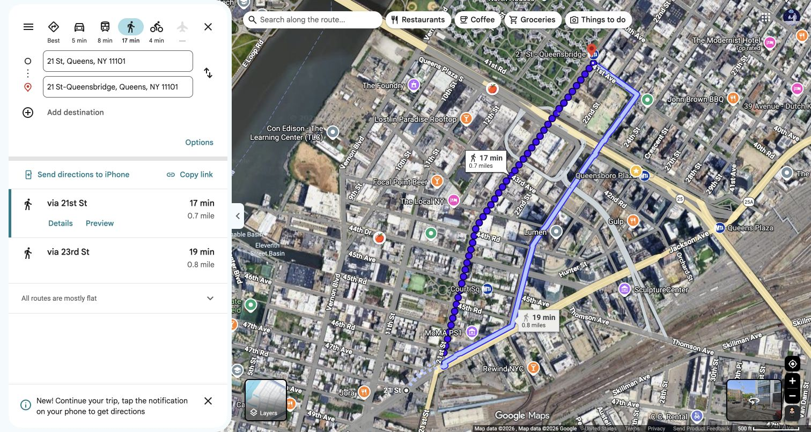

# NYC Marathon spectator itinerary: McCarren Park → Roosevelt Island Tram

**Race day:** Sunday, November 1, 2026  
**Runner's plan:** 10:20 a.m. start; about 8:30 per mile  
**Spectator goal:** Cheer at Bedford Avenue beside McCarren Park, then ride the Roosevelt Island Tram toward Manhattan with a view of the marathon field on the Queensboro Bridge.

> **Timing reality:** Seeing the runner at McCarren Park is the planned sighting. Seeing that same runner from the tram is possible only if every connection is quick. The walk between the G and F stations in Queens is about **17 minutes**, and the runner is expected on the bridge around **12:28–12:36 p.m.** Take the tram for the bridge view, but do not count on identifying the runner there.

## Timing at 8:30 per mile

| Place | Approximate course distance | Runner's estimated time |
| --- | ---: | ---: |
| Bedford Avenue at North 12th Street, McCarren Park | ~11.5 miles | ~11:58 a.m. |
| Mile 12, just beyond Bedford Avenue | 12 miles | 12:02 p.m. |
| Queensboro Bridge | ~15–16 miles | ~12:28–12:36 p.m. |

These are pace estimates from a **10:20 a.m. start-line crossing**, not official tracking predictions. Start-line delay, crowding, stops, and hills can shift them. Use the [NYRR runner tracker](https://www.nyrr.org/tcsnycmarathon/race-day/watch-the-race) on race day.

## Spectator steps

| When | What to do |
| --- | --- |
| **By 11:45 a.m.** | Stand on the **McCarren Park side of Bedford Avenue at North 12th Street**. [Open the viewing spot in Google Maps](https://www.google.com/maps/search/?api=1&query=Bedford+Ave+and+N+12th+St+Brooklyn+NY). Agree on this corner in advance so the runner knows where to look. |
| **~11:55 a.m.–noon** | Watch for the runner. Once they pass, leave promptly. |
| **~Noon–12:07 p.m.** | Walk on the **park side**, toward [Nassau Avenue G station](https://www.google.com/maps/search/?api=1&query=Nassau+Ave+G+station+Brooklyn+NY). Google Maps shows a **7-minute, 0.3-mile route via Nassau Avenue**. Choose that route; its faster suggestion along Bedford follows the race course. [Open walking directions](https://www.google.com/maps/dir/?api=1&origin=Bedford+Ave+%26+N+12th+St,+Brooklyn,+NY&destination=Nassau+Ave+Station,+Manhattan+Ave+%26+Nassau+Ave,+Brooklyn,+NY&travelmode=walking). |
| **Next** | Take the **Queens-bound G** from Nassau Avenue to **21 St**. It is two stops: Greenpoint Avenue, then 21 St. |
| **Allow ~17 minutes** | Exit the G and walk to the separate [21 St–Queensbridge F station](https://www.google.com/maps/search/?api=1&query=21+St-Queensbridge+F+station+Queens+NY). Google Maps measures this walk at **0.7 mile**. [Open walking directions](https://www.google.com/maps/dir/?api=1&origin=21+St+G+Station,+Queens,+NY&destination=21+St-Queensbridge+F+Station,+Queens,+NY&travelmode=walking). |
| **Next** | Take the **Manhattan-bound F one stop** to **Roosevelt Island**. On the island, [walk about 3 minutes to the tram station](https://www.google.com/maps/dir/?api=1&origin=Roosevelt+Island+F+Station,+Roosevelt+Island,+NY&destination=Roosevelt+Island+Tramway+-+Island+station,+Roosevelt+Island,+NY&travelmode=walking). |
| **Likely ~12:40–1:00 p.m., depending on waits** | Board a **Manhattan-bound Roosevelt Island Tram**. Face the Queensboro Bridge for a view of runners on its lower level. The tram runs **beside** the bridge and ends at East 60th Street and Second Avenue. |

### Map screenshots

The screenshots show walking directions captured before race day. They are orientation aids; follow street closures and station signs on November 1.

**McCarren Park viewing spot → Nassau Avenue G:** choose the 7-minute park-side option shown by the dotted route.

**21 St G → 21 St–Queensbridge F:** this is a street-level, 17-minute walk, not an in-station transfer.

**Roosevelt Island F → tram:** about a 3-minute walk.

## Before leaving

- Check [MTA service](https://www.mta.info/) for the **G and F** on race morning. Weekend changes can alter this route.
- Check [Roosevelt Island Tram service](https://www.rioc.ny.gov/community/transportation/tram) and allow for a line. Published frequency is about **7.5–15 minutes** depending on service period.
- Bring the runner's bib number for [NYRR tracking](https://www.nyrr.org/tcsnycmarathon/race-day/watch-the-race). If the McCarren split is later than expected, adjust the tram plan rather than rushing across the race course.

**Route source:** [NYRR's official 2026 course map](https://cms.prod.nyrr.org/api/document-files/file/TCSNYCM26_Map_Course_090226_RD3.pdf). [MTA G](https://www.mta.info/schedules/subway/g-train) and [F](https://www.mta.info/schedules/subway/f-train) schedules give the planned subway route; live directions may suggest another route on race day.
