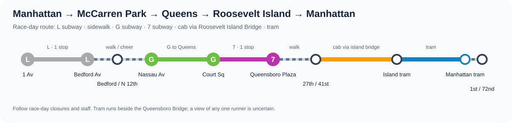
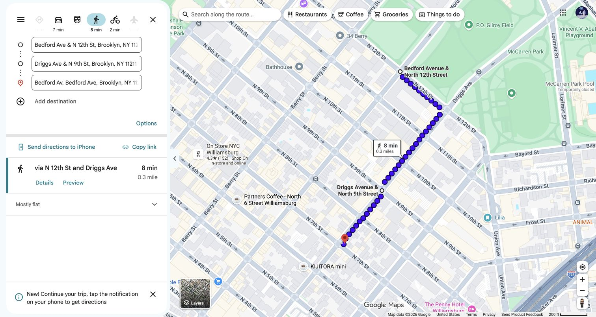
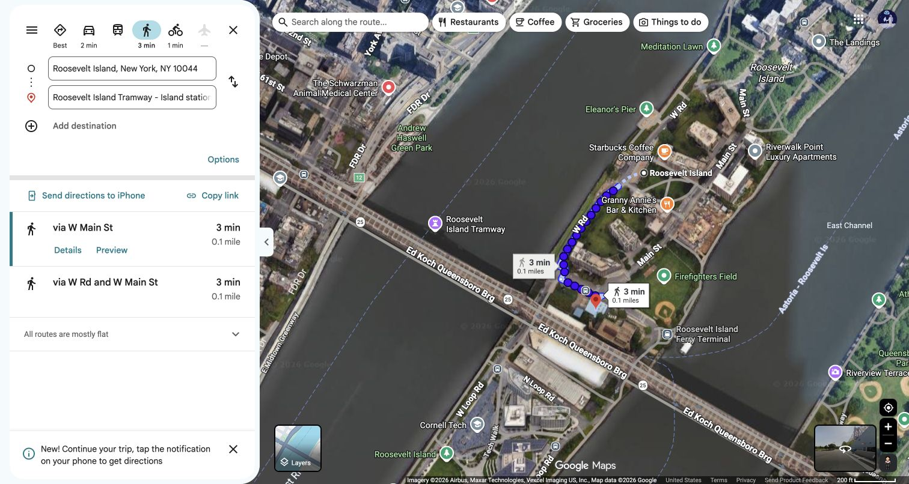
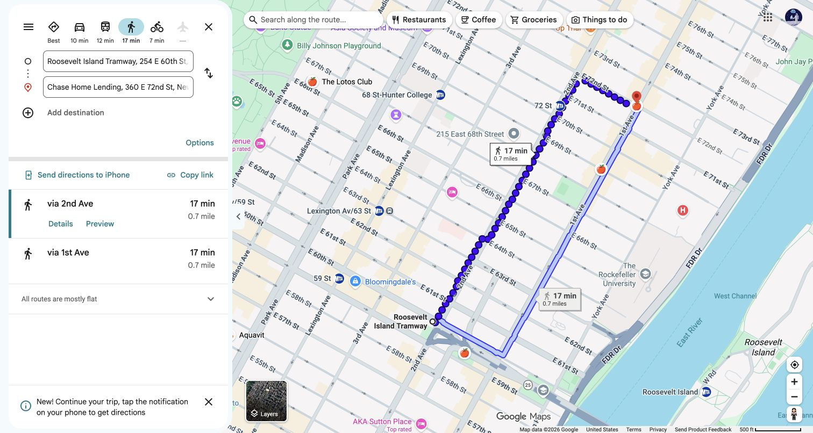

# NYC Marathon spectator route: McCarren Park → Roosevelt Island Tram → First Avenue

**Sunday, November 1, 2026** · Runner starts about **10:20 a.m.** and expects **8:30 per mile**.

The plan is to see the runner once at **Bedford Avenue and North 12th Street**, ride the **L and F trains onto Roosevelt Island**, take the **tram beside the Queensboro Bridge into Manhattan**, then walk to the designated pedestrian crossing at **First Avenue and East 72nd Street**.

> **The important timing:** The runner should reach McCarren Park around **11:58 a.m.**, the Queensboro Bridge around **12:28–12:36 p.m.**, and First Avenue at East 72nd Street around **12:41–12:44 p.m.** The full spectator trip will likely reach the tram and East 72nd Street *after* the runner. The tram is for a view of the **race field**, not a reliable second sighting of this runner.

## Step-by-step itinerary

| Time | Mode | Directions |
| --- | --- | --- |
| **By 11:45 a.m.** | Walk | Arrive at the **McCarren Park side of Bedford Avenue at North 12th Street**. [Viewing spot](https://www.google.com/maps/search/?api=1&query=Bedford+Ave+and+N+12th+St+Brooklyn+NY). Agree on this exact side of the street with the runner ahead of time. |
| **~11:55 a.m.–noon** | Cheer | Look for the runner, expected around **11:58 a.m.** Leave when they pass. |
| **~noon–12:10 p.m.** | **Walk** | Stay **east of Bedford Avenue**, away from the race course. Follow **North 12th Street → Driggs Avenue → North 7th Street** to the [Bedford Avenue L station](https://www.google.com/maps/search/?api=1&query=Bedford+Ave+L+station+Brooklyn+NY). Google Maps measures this walk at **0.3 mile / 8 minutes**. [Walking directions with Driggs waypoint](https://www.google.com/maps/dir/?api=1&origin=Bedford+Ave+%26+N+12th+St,+Brooklyn,+NY&destination=Bedford+Ave+L+Station,+Bedford+Ave+%26+N+7th+St,+Brooklyn,+NY&waypoints=Driggs+Ave+%26+N+9th+St,+Brooklyn,+NY&travelmode=walking). |
| **Next** | **L train** | Take a **Manhattan-bound L toward 8 Av** from Bedford Av to **6 Av**. This route goes beneath the East River and avoids the street closures. |
| **At 14 St–6 Av** | **Transfer** | Follow signs inside the station for the **F toward Queens/Jamaica**. No street-level transfer is needed. |
| **Next** | **F train** | Ride to **Roosevelt Island**. The [island's transit page](https://www.rioc.ny.gov/community/transportation/subway) identifies the F as its weekend subway service. This is the leg that gets spectators **onto Roosevelt Island**. |
| **On Roosevelt Island** | **Walk** | Exit the subway and walk about **3 minutes** to the [island tram station](https://www.google.com/maps/dir/?api=1&origin=Roosevelt+Island+F+Station,+Roosevelt+Island,+NY&destination=Roosevelt+Island+Tramway+-+Island+station,+Roosevelt+Island,+NY&travelmode=walking). |
| **Likely ~12:45–1:05 p.m.** | **Tram** | Board a **Manhattan-bound Roosevelt Island Tram**. Face the Queensboro Bridge; the tram runs **beside** it, giving a view of runners on the bridge. It arrives at **East 60th Street and Second Avenue**. Train waits and the tram line can shift this time. |
| **After the tram** | **Walk** | Go north on **Second Avenue**, then east on **East 72nd Street** to [First Avenue and East 72nd Street](https://www.google.com/maps/search/?api=1&query=40.7678056,-73.9560278). Google Maps gives **0.7 mile / 17 minutes**. [Walking directions](https://www.google.com/maps/dir/?api=1&origin=Roosevelt+Island+Tramway+Manhattan+Station,+E+60th+St+and+2nd+Ave,+New+York,+NY&destination=40.7678056,-73.9560278&travelmode=walking). This is an **official pedestrian crossing zone**. Cross First Avenue only when staff open it; otherwise watch the passing field from the west side. |

## Map screenshots

These show the **walking portions**. The L → F subway ride and the tram are shown in the route diagram above. Google Maps' future-date transit suggestions can omit trains or suggest buses that may be diverted near the course, so follow the named train lines and check MTA service on race morning.

**1. McCarren Park → Bedford Avenue L**, using North 12th Street and Driggs Avenue to stay off Bedford's race route:

**2. Roosevelt Island F station → island tram station:**

**3. Manhattan tram station → First Avenue and East 72nd Street crossing:**

## Race-day checks and closures

- [NYRR's 2026 course page](https://prod.nyrr.org/tcsnycmarathon/the-course) lists **First Avenue and East 72nd Street** as a managed pedestrian crossing. It also says streets along the race close early. Do not plan to cross Bedford Avenue or First Avenue wherever convenient, and do not use a road bus as the main way across the course.
- Check [MTA service alerts](https://www.mta.info/alerts) for the **L and F** on November 1. The published weekend F route serves Roosevelt Island, but last-minute service changes are possible.
- Check [Roosevelt Island Tram service](https://www.rioc.ny.gov/community/transportation/tram) before boarding and allow for a line. The tram runs frequently, but the ride cannot be timed to one runner with certainty.
- Track the runner using the [NYRR app](https://www.nyrr.org/tcsnycmarathon/race-day/watch-the-race). All runner times above assume the **10:20 a.m. start is the actual start-line crossing** and the pace stays near 8:30/mile.

[Official 2026 course map](https://cms.prod.nyrr.org/api/document-files/file/TCSNYCM26_Map_Course_090226_RD3.pdf) · [MTA L service](https://www.mta.info/schedules/subway/l-train) · [MTA F service](https://www.mta.info/schedules/subway/f-train)
